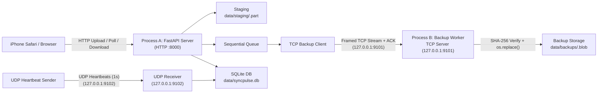

# SyncPulse

**Self-Hosted File Backup & Infrastructure Monitoring System**

> A lightweight self-hosted backup service that transfers files over raw **TCP** sockets with SHA-256 integrity verification, monitors worker health through **UDP** heartbeats, and provides real-time infrastructure visibility through a mobile-friendly web dashboard.

---

## 1. Problem Statement

Many users want to back up important files from a smartphone to a personal computer on their local Wi-Fi without paying for cloud storage subscriptions—while still knowing:
1. Whether each backup actually completed with verified file integrity (SHA-256),
2. Whether the backup service is currently alive or unresponsive, and
3. How to retry failed backups and review incident history.

**SyncPulse** solves this with a zero-cost, self-hosted local architecture designed to run on a single Windows laptop and be operated from **iPhone Safari** (no native iOS app required).

---

## 2. Key Features

- **Mobile-First Web Dashboard**: Upload, verify, download, and retry backups directly from iPhone Safari or desktop browsers.
- **Custom Framed TCP File Transfer**: Separate Backup Worker process receiving length-prefixed JSON metadata, chunked binary streams (64 KiB), and returning framed JSON ACKs.
- **End-to-End SHA-256 Integrity & Atomic Commit**: Incoming streams write to `.part` files, verify byte length and SHA-256 digest, and atomically commit via `os.replace()`.
- **Idempotent Retry Support**: Full-file retry on failures with duplicate `transfer_id` detection (`OK` on exact hash match, `DUPLICATE_CONFLICT` on mismatch).
- **Real UDP Heartbeat Monitoring**: Independent 1-second UDP datagrams with receiver-clock timeout detection (`STARTING` → `HEALTHY` → `UNRESPONSIVE` → `RECOVERED`) and session-change awareness.
- **Liveness vs. Backup Health Separation**: Clearly distinguishes UDP worker liveness from TCP transfer health and HTTP API health.
- **Local Host Telemetry & Incident History**: Live CPU/Memory/Disk metrics via `psutil` and persistent SQLite event logs.

---

## 3. System Architecture



Detailed design docs:
- [docs/architecture.md](docs/architecture.md)
- [docs/protocol-design.md](docs/protocol-design.md)
- [docs/cloud-extension.md](docs/cloud-extension.md)

---

## 4. Tech Stack

- **Backend**: Python 3.13, FastAPI, Uvicorn, `asyncio` raw TCP/UDP sockets, SQLite (WAL mode), `psutil`, Pydantic
- **Frontend**: React 19, TypeScript, Vite (production build served directly by FastAPI)
- **Testing**: `pytest`, `pytest-asyncio`, `httpx`
- **Operations**: Windows PowerShell runner scripts, optional Wireshark + Npcap

---

## 5. Protocol Flows

### TCP File Transfer (`127.0.0.1:9101`)
1. Browser uploads file to FastAPI (`POST /api/transfers`), which streams into `data/staging/<transfer_id>.part` and calculates SHA-256.
2. Background queue consumer opens a raw TCP socket to the Backup Worker.
3. Client sends a **4-byte unsigned big-endian length header** + UTF-8 JSON metadata (`version`, `transfer_id`, `original_filename`, `byte_size`, `sha256`).
4. Client streams exact `byte_size` bytes in 64 KiB chunks.
5. Worker reads exact bytes into `data/backups/<transfer_id>.part`, computes SHA-256, verifies byte count and digest, atomically moves to `.blob`, and replies with a 4-byte length-prefixed JSON ACK.
6. API transitions the job to `VERIFIED` only after receiving an `OK` ACK with matching `stored_sha256`.

### UDP Heartbeat (`127.0.0.1:9102`)
1. Backup Worker sends a small UTF-8 JSON UDP datagram every `1.0s` containing `worker_id`, `session_id`, `sequence_number`, `timestamp_utc`, and `uptime_seconds`.
2. API Server evaluates liveness strictly using **receiver arrival time**.
3. Missing heartbeats for `4.0s` trigger `WORKER_UNRESPONSIVE` in `health_events`.
4. Restarting the Worker generates a new `session_id`, triggers `WORKER_RECOVERED`, and resets the sequence baseline without false packet-loss counts.

> **Loopback Disclosure:** When both processes run on a single Windows laptop, TCP `:9101` and UDP `:9102` use the OS loopback stack (`127.0.0.1`). Real socket I/O occurs, but physical WAN latency and router packet loss are not claimed.

---

## 6. Setup & Execution (Windows)

### Prerequisites
- Python 3.12+
- Node.js 20+ & npm
- Git

### 1. Install Backend Dependencies
```powershell
cd syncpulse
python -m venv .venv
.\.venv\Scripts\python.exe -m pip install -r backend\requirements.txt
```

### 2. Build Frontend Production Bundle
```powershell
cd frontend
npm install
npm run build
cd ..
```

### 3. Run SyncPulse (Two Independent Processes)

**Terminal 1 — Start Backup Worker (Process B):**
```powershell
.\scripts\run-worker.ps1
```

**Terminal 2 — Start API & Web Server (Process A):**
```powershell
.\scripts\run-api.ps1
```

### 4. Access from Windows & iPhone Safari
- **Windows Browser:** `http://127.0.0.1:8000`
- **iPhone Safari (same private Wi-Fi):** Open the `http://<your-laptop-ip>:8000` URL printed by `run-api.ps1` (or find IPv4 via `ipconfig`).

If iPhone cannot connect, check Windows Defender Firewall for private-network TCP port `8000` and Wi-Fi AP isolation (see [docs/troubleshooting.md](docs/troubleshooting.md)).

---

## 7. Automated Tests & Verification

Run the full unit, TCP/UDP integration, HTTP API, and fault-injection test suite:
```powershell
.\scripts\run-tests.ps1
```

Verified results recorded in [docs/test-results.md](docs/test-results.md):
- **37/37 automated tests passed** (TCP framing, 7-byte fragmented writes, checksum mismatch, idempotency, UDP timeout/recovery, controlled drop injection, HTTP API, worker shutdown/recovery/retry, mid-transfer cut).
- **Live two-process Windows smoke test passed** (SPA serving, real inter-process UDP heartbeats, TCP verified backup, and worker kill detection).
- **Manual items (user hardware required)**: iPhone Safari LAN test and Wireshark loopback capture (`tcp.port == 9101 or udp.port == 9102`) are documented with step-by-step instructions.

---

## 8. Fault Injection & Demo Scenarios

- **Worker Shutdown**: Press `Ctrl+C` in Terminal 1 → Dashboard switches to `UNRESPONSIVE` after 4s → upload fails cleanly with staging preserved → restart Terminal 1 → `RECOVERED` → click **Retry Backup** → `VERIFIED`.
- **Controlled UDP Heartbeat Omission** (application-level send omission, not physical network loss):
  ```powershell
  $env:SYNCPULSE_UDP_DROP_EVERY_N=5
  .\scripts\run-worker.ps1
  ```
- **Throttled Mid-Transfer Interruption**:
  ```powershell
  $env:SYNCPULSE_TCP_THROTTLE_MS=100
  .\scripts\run-api.ps1
  ```

See [docs/demo-script.md](docs/demo-script.md) for the complete 5–7 minute presentation script.

---

## 9. Scope, Limitations & Security Notice

- **Unidirectional File Backup Only**: MVP does not implement bidirectional folder sync, iPhone background photo sync, NAT traversal/P2P, or byte-offset resume (supports full-file **Retry** only).
- **No Authentication / Plain HTTP**: Designed strictly for trusted private LAN demos. **Do not expose port 8000 to public Wi-Fi or the public internet**, and do not store sensitive production data without adding HTTPS and authentication.
- **Safe Defaults**: Raw TCP (`9101`) and UDP (`9102`) bind only to `127.0.0.1`. User filenames are never used in storage paths (`transfer_id` UUIDs only).

---

## 10. Professor Requirement Compliance

| Professor Requirement | Implementation | Evidence |
|---|---|---|
| Build something | Working SyncPulse backup & monitoring web app | `backend/`, `frontend/`, live two-process smoke test |
| TCP/UDP in backend | Custom framed TCP server/client (`9101`) + UDP heartbeat sender/receiver (`9102`) | `backend/networking/tcp_*.py`, `backend/networking/udp_heartbeat.py` |
| Demonstrate protocol | Real TCP file streaming + SHA-256 ACK & UDP heartbeat timeout/recovery | `tests/integration/test_tcp_transfer.py`, `tests/integration/test_udp_heartbeat.py`, [docs/demo-script.md](docs/demo-script.md) |
| Agentic AI | AI-assisted design, implementation, debugging, and test automation | [docs/agentic-ai-log.md](docs/agentic-ai-log.md) |
| Solve real problem | Zero-cost local smartphone-to-PC verified backup with outage detection | End-to-end backup & retry workflow |
| Technical skills | Raw sockets, framing, SHA-256, SQLite, FastAPI, React/TS, fault injection | [docs/architecture.md](docs/architecture.md), [docs/test-results.md](docs/test-results.md) |
| Publish work | Clean Git history, `.gitignore` excluding runtime data/DBs, full docs | Local Git repository ready for GitHub push |
| Two weeks | Scoped, verified MVP with explicit future cloud roadmap | [docs/cloud-extension.md](docs/cloud-extension.md) |
