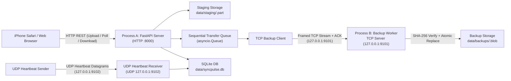

# SyncPulse System Architecture

## 1. Overview

**SyncPulse** is a self-hosted, unidirectional file backup and infrastructure monitoring system designed to run locally on a single Windows laptop and be operated from an iPhone via Safari over a trusted private LAN.

It separates concerns across two independent OS processes that communicate over real OS network sockets:

- **Process A — API & Monitoring Server (`backend.app`)**: Serves the mobile-first web dashboard, accepts HTTP file uploads into staging, manages SQLite persistence, streams staged files to the Backup Worker over a custom framed **TCP** protocol, and listens for **UDP** heartbeats to track worker liveness.
- **Process B — Backup Worker (`backend.worker`)**: Runs an independent **TCP** socket server that receives framed file streams, verifies byte length and SHA-256 integrity, commits verified files atomically to local backup storage, and emits periodic **UDP** heartbeat datagrams.

> **Scope Note:** When both processes run on the same Windows host, TCP (`127.0.0.1:9101`) and UDP (`127.0.0.1:9102`) travel through the OS loopback network stack rather than across physical network hops. The application implements genuine socket communication, while real-world WAN latency and physical packet loss are explicitly out of scope for single-host testing.

## 2. Logical Architecture

## 3. Process Boundaries & Network Ports

| Service | Protocol | Default Bind | Configurable Env | Purpose |
|---|---|---|---|---|
| API & Web UI | HTTP (TCP) | `0.0.0.0:8000` | `SYNCPULSE_API_HOST`, `SYNCPULSE_API_PORT` | Mobile/desktop web access on private LAN |
| Backup Worker | Raw TCP Socket | `127.0.0.1:9101` | `SYNCPULSE_TCP_HOST`, `SYNCPULSE_TCP_PORT` | Framed binary file transfer + JSON ACK |
| Heartbeat Monitor | Raw UDP Socket | `127.0.0.1:9102` | `SYNCPULSE_UDP_HOST`, `SYNCPULSE_UDP_PORT` | Worker liveness monitoring |

Only HTTP port `8000` is exposed to the local LAN so iPhone Safari can connect. Internal TCP and UDP sockets remain bound to `127.0.0.1` by default.

## 4. Two-Stage Backup Lifecycle

Uploading a file from Safari does not immediately mark it as backed up. SyncPulse enforces two distinct phases:

1. **HTTP Upload & Staging (`STAGED` → `QUEUED`)**:
   - FastAPI streams the multipart upload into `data/staging/<transfer_id>.part` while enforcing `MAX_FILE_SIZE_BYTES` (default 50 MiB) and computing the original SHA-256 digest.
   - A `transfers` row is persisted in SQLite and enqueued onto a single-concurrency `asyncio.Queue`.
   - The HTTP response returns immediately with the `transfer_id` so the UI can track the TCP phase separately.

2. **TCP Transfer & Verification (`TRANSFERRING` → `VERIFIED` | `FAILED`)**:
   - The background consumer connects to the Backup Worker over TCP, sends length-prefixed JSON metadata, and streams the staged file in 64 KiB chunks.
   - The Backup Worker writes incoming bytes to `data/backups/<transfer_id>.part`, computes SHA-256 on the fly, verifies exact byte length and digest match, atomically moves the file to `data/backups/<transfer_id>.blob` via `os.replace()`, and sends a framed JSON ACK.
   - Only after receiving a `status == "OK"` ACK with matching `stored_sha256` does the API Server mark the transfer `VERIFIED`.
   - If any step fails, the transfer is marked `FAILED`, the staging file is preserved, and the user can trigger a full-file **Retry** (not byte-offset Resume).

## 5. Health Model: Liveness vs. Operation Health

A key operational distinction in SyncPulse is separating three health signals:

1. **API Health (`GET /api/health`)**: Whether the FastAPI process is responding to HTTP requests.
2. **Worker Liveness (UDP Heartbeat)**: Whether the Backup Worker is actively emitting UDP heartbeats within the configured timeout (default 4 seconds). States: `STARTING`, `HEALTHY`, `UNRESPONSIVE`, `RECOVERED`.
3. **Backup Operation Health**: Whether actual TCP file transfers are succeeding or failing. A worker can be `HEALTHY` (sending UDP heartbeats) while TCP transfers fail (e.g., disk or checksum error).

## 6. Database Schema (SQLite)

The API Server is the single writer to `data/syncpulse.db` (WAL mode enabled). All timestamps are stored as timezone-aware UTC ISO-8601 strings and formatted to local time (KST) in the frontend.

- **`transfers`**: `id` (UUID PK), `original_filename`, `file_size`, `original_sha256`, `stored_sha256`, `status`, `staging_path`, `storage_path`, `bytes_transferred`, `attempt_count`, `error_code`, `error_message`, `created_at`, `started_at`, `completed_at`, `upload_duration_ms`, `tcp_connect_ms`, `transfer_duration_ms`, `total_duration_ms`.
- **`health_events`**: `id` (autoincrement PK), `worker_id`, `session_id`, `event_type`, `previous_status`, `new_status`, `details`, `created_at`.
- **`worker_state`**: `worker_id` (PK), `session_id`, `current_status`, `last_sequence_number`, `last_seen_at`, `started_at`, `updated_at`.

## 7. Startup Recovery Policy

- **API Server Restart**: Any transfer left in `TRANSFERRING` or `QUEUED` from a prior unexpected shutdown is transitioned to `FAILED` (`error_code = "API_RESTART_INTERRUPTED"`). It is never assumed `VERIFIED`. The `worker_state` in memory starts as `STARTING` until a live UDP heartbeat is received.
- **Backup Worker Restart**: Leftover `.part` files in `data/backups/` are removed on startup. A fresh `session_id` (UUID) is generated so the monitoring service distinguishes a restart from dropped UDP datagrams.
